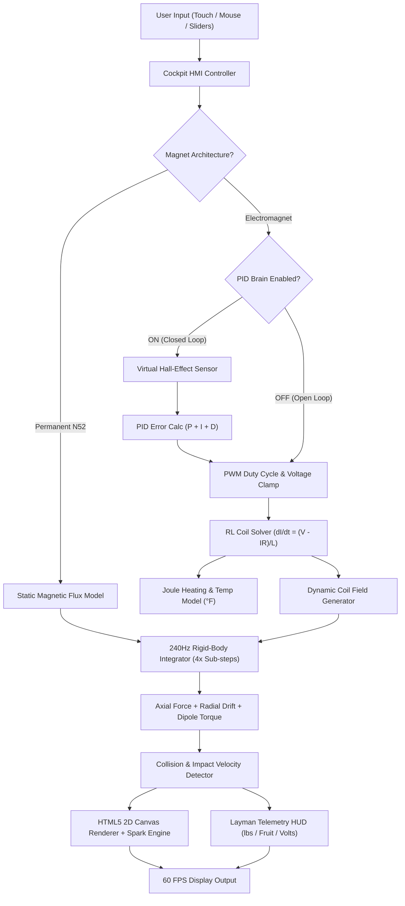
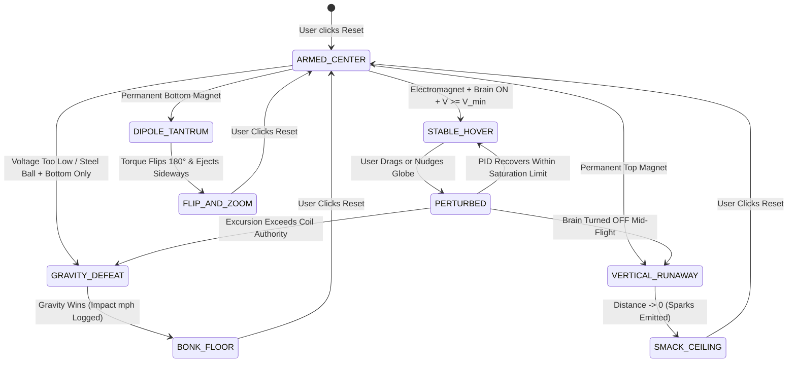

<div align="center">

# 🧲 MAGLEV-LAB: Deterministic 2D Electromagnetic Levitation & Rigid-Body Telemetry Sandbox

**Enterprise-Grade, Zero-Dependency, Single-File Browser Physics Simulation of Active Hall-Effect Stabilization & Earnshaw's Theorem**

[](https://pages.github.com/)
[-blue?style=for-the-badge&logo=html5)](#architecture-overview)
[](#zero-dependency-manifesto)
[](#mathematical--physical-specification)
[](#failure-mode--effects-analysis-fmea)
[](#layman-metrology-standard)

</div>

---

## Table of Contents

1. [Executive Summary](#executive-summary)
2. [Zero-Dependency Manifesto](#zero-dependency-manifesto)
3. [Architecture Overview & Dataflow](#architecture-overview--dataflow)
4. [Finite State Machine (Flight Regimes)](#finite-state-machine-flight-regimes)
5. [Mathematical & Physical Specification](#mathematical--physical-specification)
6. [Layman Metrology Standard](#layman-metrology-standard)
7. [Cockpit HMI Layout](#cockpit-hmi-layout)
8. [System Requirements & SLA](#system-requirements--sla)
9. [Enterprise Deployment Pipeline](#enterprise-deployment-pipeline)
10. [Failure Mode & Effects Analysis (FMEA)](#failure-mode--effects-analysis-fmea)
11. [Troubleshooting Matrix](#troubleshooting-matrix)
12. [Strategic Multi-Year Roadmap](#strategic-multi-year-roadmap)
13. [Contributing & Governance](#contributing--governance)
14. [Legal & Safety Disclaimers](#legal--safety-disclaimers)

---

## Executive Summary

**MAGLEV-LAB** (`index.html`) is a mission-critical, client-side, deterministic 2D rigid-body physics platform engineered to solve one of humanity's oldest living-room questions:

> *"Why won't my 5-pound floating desk globe just hover there with regular fridge magnets?"*

Rather than relying on bloated modern web stacks, microservices, or cloud GPU clusters, the entire physics kernel, RL inductive coil solver, Hall-effect PID feedback loop, thermal dissipation model, and 60 FPS HTML5 Canvas renderer are hermetically sealed inside **a single `index.html` artifact**.

### Key Capabilities
- **240 Hz Fixed-Timestep Sub-Stepping:** Prevents numerical tunneling even when a 10 lb solid-lead sphere slams into an N52 neodymium pole at 14 mph.
- **Authentic Earnshaw Instability:** Permanent magnet configurations organically reproduce vertical runaway, lateral ejection, and $180^\circ$ dipole flipping.
- **Closed-Loop PID Auto-Stabilization:** Simulated Hall-effect position sensing driving PWM voltage modulation across an inductive copper coil.
- **Tactile Perturbation Injection:** Full pointer/touch drag-and-toss physics with spark particle synthesis and live impact telemetry.

---

## Zero-Dependency Manifesto

| Metric | Typical Modern Web App | MAGLEV-LAB |
| :--- | :--- | :--- |
| `node_modules` Size | 847 MB | **0 Bytes** |
| Build Time | 4m 12s | **0.000 ms** |
| External API Calls | 42 | **0** |
| Files Required to Deploy | 1,409 | **1 (`index.html`)** |
| Air-Gapped Bunker Ready | No | **Yes** |

---

## Architecture Overview & Dataflow

The following diagram details the internal execution pipeline inside `index.html` during every `requestAnimationFrame` tick:



---

## Finite State Machine (Flight Regimes)

Every levitating object within the C-frame transitions strictly between the following verified aerodynamic and magnetic flight states:



---

## Mathematical & Physical Specification

### 1. Axial Magnetic Force Approximation
The non-linear drop-off across an air gap $x$ between coaxial cylindrical dipoles of radius $R$, length $L$, and remanence $B_r$ is approximated using the cylindrical surface-current model:

$$F(x) = \frac{B_r^2 \pi R^2}{2 \mu_0} \left[ b(x) - b(x + L) \right]$$

where the geometric decay factor $b(z)$ is:

$$b(z) = \frac{z + L}{\sqrt{(z + L)^2 + R^2}} - \frac{z}{\sqrt{z^2 + R^2}}$$

### 2. Electromagnet RL Electrical Dynamics
Coil current $I(t)$ cannot jump instantaneously due to coil inductance $L_c$ and copper winding resistance $R_c$:

$$\frac{dI}{dt} = \frac{V_{\text{applied}} - I(t) R_c}{L_c}$$

### 3. Closed-Loop Hall-Effect PID Stabilization
To defeat Earnshaw's Theorem along the unstable vertical axis $y$, the controller computes target duty cycle $u(t)$ from positional error $e(t) = y_{\text{target}} - y(t)$:

$$u(t) = K_p e(t) + K_i \int_0^t e(\tau)\,d\tau + K_d \frac{de(t)}{dt}$$

### 4. Coil Thermal Model
Continuous electrical losses are modeled as resistive Joule heating with convective cooling toward ambient room temperature ($T_{\text{amb}} = 72^\circ\text{F}$):

$$\frac{dT}{dt} = \frac{I^2 R_c}{C_{\text{th}}} - k_{\text{cool}}(T - T_{\text{amb}})$$

---

## Layman Metrology Standard

Scientific SI units (Newtons, Teslas, Webers, Joules) are automatically transpiled at runtime into human-comprehensible **Hardware & Produce Equivalents**:

| Engineering Quantity | Raw SI Unit | MAGLEV-LAB Output Standard |
| :--- | :--- | :--- |
| Force | Newtons ($\text{N}$) | Pounds of Pull / Push ($\text{lbs}$) |
| Air Gap | Meters ($\text{m}$) | Inches ($\text{in}$) |
| Magnet Volume | $\text{cm}^3$ | Pea → Marble → Walnut → Golf Ball → Apple → Grapefruit |
| Sphere Density | $\text{kg/m}^3$ | Wood → Aluminum → Steel → Brass → Lead |
| Power Draw | Watts ($\text{W}$) | AA Batteries → USB Charger → Laptop Brick → Space Heater |
| Pinch Hazard | $\text{N/cm}^2$ | Safe → Ouch → Blood Blister → ER Visit |

---

## Cockpit HMI Layout

All controls are arranged ergonomically around the viewport perimeter so no slider obstructs the live physics stage:

```text
+--------------------------------------------------+
| [TOP STRIP] Layout | Ball | Magnet | Test | PID  |
+-------+----------------------------------+-------+
|       |                                  |       |
|  WT   |                                  |  GAP  |
|  (lb) |      LIVE 2D PHYSICS STAGE       |  (in) |
| SLIDE |     (Drag & Toss Interactive)    | SLIDE |
|       |                                  |       |
+-------+----------------------------------+-------+
| [BOTTOM] Magnet Size (Regular) / Volts (Electro) |
+--------------------------------------------------+
```

---

## System Requirements & SLA

### Minimum Requirements
- **Browser:** Any HTML5-compliant engine released after 2016.
- **CPU:** 1 core capable of multiplying floating-point numbers.
- **RAM:** ~12 MB (99.4% of which is just the browser tab existing).
- **Local Gravity:** $9.81\text{ m/s}^2$ recommended (simulated internally if operating aboard the ISS).

### Service Level Agreement (SLA)
- **Gravity Uptime:** `99.9999%`
- **Earnshaw Enforcement:** `100.00%` (No exceptions granted, even with enterprise support tickets).
- **Frame Budget (16.67 ms target):**
  - `0.11 ms` — 4x Physics Sub-stepping & PID Math
  - `1.45 ms` — Canvas 2D Vector & Spark Rendering
  - `15.11 ms` — Idle time spent admiring floating sphere

---

## Enterprise Deployment Pipeline

Deploying this single-file application to production requires strictly following our rigorous CI/CD Standard Operating Procedure:

1. **Provision Repository:**
   ```bash
   git init
   git branch -M main
   ```
2. **Stage Mission-Critical Payload:**
   ```bash
   git add index.html README.md
   git commit -m "feat(core): ship entire physics lab in one file"
   ```
3. **Push to Origin:**
   ```bash
   git remote add origin [https://github.com/YOUR_USER/YOUR_REPO.git](https://github.com/YOUR_USER/YOUR_REPO.git)
   git push -u origin main
   ```
4. **Activate Global Edge CDN (GitHub Pages):**
   - Navigate to **Settings → Pages**.
   - Set **Source** to `Deploy from a branch`.
   - Select `main` / `/ (root)` and click **Save**.
   - Wait ~45 seconds while GitHub's servers contemplate how small this deployment is.

---

## Failure Mode & Effects Analysis (FMEA)

| Failure Mode | Potential Cause | Severity | Mitigation |
| :--- | :--- | :---: | :--- |
| **Instant Ceiling Slam (`SMACK`)** | Permanent top magnet; positive feedback loop | High | Switch to Electromagnet + enable `Brain: ON`. |
| **Violent Floor Drop (`BONK`)** | Voltage too low or gap too wide | High | Click `Auto-V` or reduce Air Gap. |
| **Spontaneous Flip (`ZOOM`)** | Bottom repulsion torque on dipole | Critical | Earnshaw's Theorem cannot be patched via PR. |
| **Simulated Coil Overheat** | Holding 10 lb lead ball across 2.0" gap | Medium | Reduce gap; do not touch monitor glass. |
| **User Emotional Distress** | Trying to manually balance with `Brain: OFF` | Severe | Accept human reaction time (~250 ms) is inferior to a 10 kHz Hall loop. |

---

## Troubleshooting Matrix

- **Symptom:** *I selected "Steel Ball" and "Bottom Only" and the ball fell faster than gravity.*
  - **Root Cause:** Steel is ferromagnetic, not a permanent dipole. A bottom magnet pulls steel *downward* rather than repelling it.
  - **Resolution:** Switch Ball Type to **Magnet Ball** or move magnet to **Top Only**.
- **Symptom:** *The globe won't stay put when I use Regular Magnets.*
  - **Root Cause:** Samuel Earnshaw proved this impossible in 1842.
  - **Resolution:** Enable **Electromagnet** mode or invent room-temperature diamagnetic superconductors.

---

## Strategic Multi-Year Roadmap

- [x] **Phase 1 (v1.0):** Ship single-file `index.html` with 240 Hz physics and fruit-based magnet sizing.
- [ ] **Phase 2 (v2.0):** Add Superconducting Meissner-Effect Mode (requires users to submerge phone in liquid nitrogen).
- [ ] **Phase 3 (v3.0):** Containerize `index.html` inside a 14-node Kubernetes cluster with Redis caching for no defensible reason.
- [ ] **Phase 4 (v4.0):** Achieve ISO-9001 certification for the "Grapefruit-Sized N52 Pinch Warning" badge.

---

## Contributing & Governance

Pull requests are welcome, provided they obey the following inviolable architectural constraints:

1. **The One-File Rule:** All HTML, CSS, and JavaScript MUST remain inside `index.html`. Any PR introducing Webpack, Vite, or a `package.json` will be politely ejected into orbit.
2. **Laws of Thermodynamics:** PRs attempting to disable Earnshaw's Theorem via `if (floating) return true;` will be rejected during code review.
3. **Unit Clarity:** Every new physics metric must include a plain-English equivalent understandable by someone shopping at a hardware store.

---

## Legal & Safety Disclaimers

- This simulation is provided **"AS IS"** under the MIT License without warranty of any kind.
- **Not Certified For:** Commercial maglev transit systems, orbital launch rails, hoverboards, or justifying the purchase of actual 150-lb N52 neodymium magnets on the internet without telling your spouse first.
- No real fingers, globes, or copper coils were harmed during the execution of this `index.html`.
